# EDF Humanoid: from concept art to a flight-capable design, validated in simulation

**A slender 0.88 m humanoid whose forearms and shins are electric-ducted-fan pods.** It stands, walks, hovers, takes off and lands, flies small maneuvers, and survives a fan failure. Every behavior uses **one hardware-constrained robot model** built from real, purchasable parts, and every policy is evaluated on 100 randomized trials.

<table>
<tr>
<td align="center">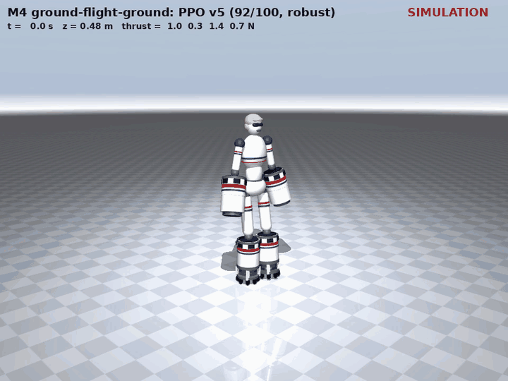<br><b>Stand → liftoff → hover → land</b><br>92–94% of trials (2× speed)</td>
<td align="center">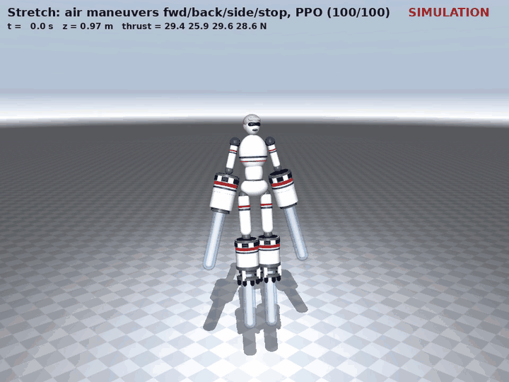<br><b>Fly forward / back / sideways, stop</b><br>100%, 0.07 m/s velocity error</td>
</tr>
<tr>
<td align="center">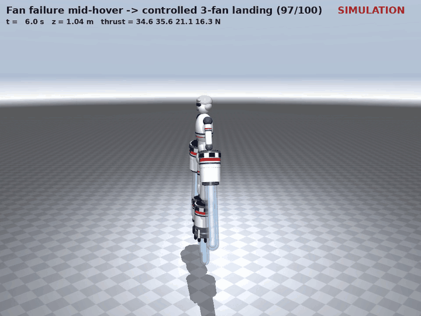<br><b>One fan dies mid-hover → safe landing</b><br>97% (0% without training)</td>
<td align="center">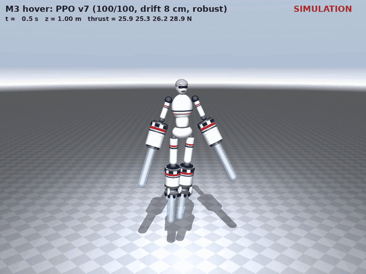<br><b>Hover</b><br>100%, altitude held to about 2 cm</td>
</tr>
<tr>
<td align="center">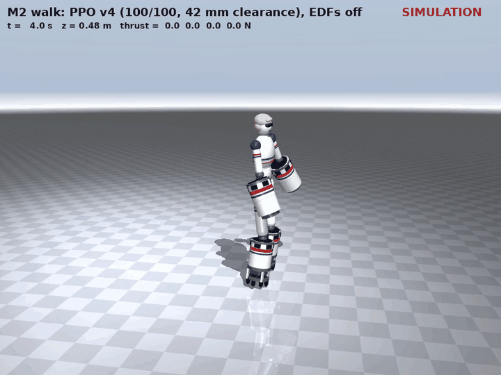<br><b>Walk, fans off</b><br>100%, 42 mm step clearance</td>
<td align="center">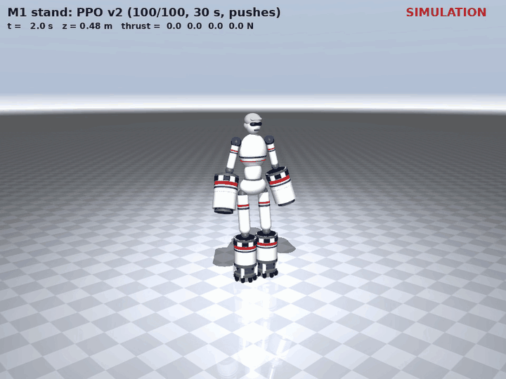<br><b>Stand under pushes, fans off</b><br>100%</td>
</tr>
</table>

<p align="center"><a href="results/hero.mp4">▶ Full 2-minute video (hover, takeoff to landing, fan failure)</a></p>

> **All results are physics simulation (MuJoCo), not flight tests.** Thrust is applied as forces along each fan's real axis, using manufacturer thrust curves plus spin-up lag, battery sag and current limits. The exhaust plumes in the clips are drawn afterwards, scaled to each fan's simulated thrust. See [Limitations](#limitations).

## What this project demonstrates

1. **Novel robot design.** I turned concept art into a parametric, buildable robot: the leg pods double as the lower legs, the fans gimbal inside the shins, and the exhaust vents through a skirt.
2. **Feasibility from shelf parts, before any training.** Every part is a real catalog item with a cited spec. Eight candidate designs were built in physics and run through a 15-check feasibility gate. Only one survived, and that's the one I trained.
3. **Validation by learned control.** Reinforcement-learning policies (PPO, GPU-parallel simulation) were trained on that exact hardware model and evaluated against the project's pass criteria. Robustness sweeps found the real limits.

---

## 1. Concept

The brief: a slender, graceful humanoid with oversized EDF propulsion pods on the forearms and lower legs, in a retro USAF livery. There are no hidden rotors, wings or external frame. The **same robot** must walk and fly.

**Flight is the core requirement.** The concept art shows the robot hovering, flying forward, maneuvering and holding altitude on four thrust columns, one from each pod. That's why the pods exist and why they sit where they do. The forearm and shin pods spread four thrust points around the centre of mass, wide enough to steer attitude by thrust differences and vectoring, and the shin pods double as the lower legs so the robot can still stand and walk.

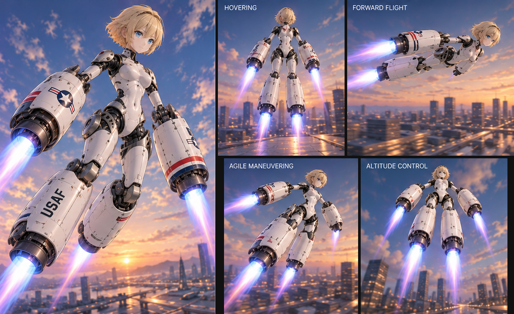

On the ground, the same pods become the robot's lower legs. Here is the concept turnaround next to the physics model built from it:

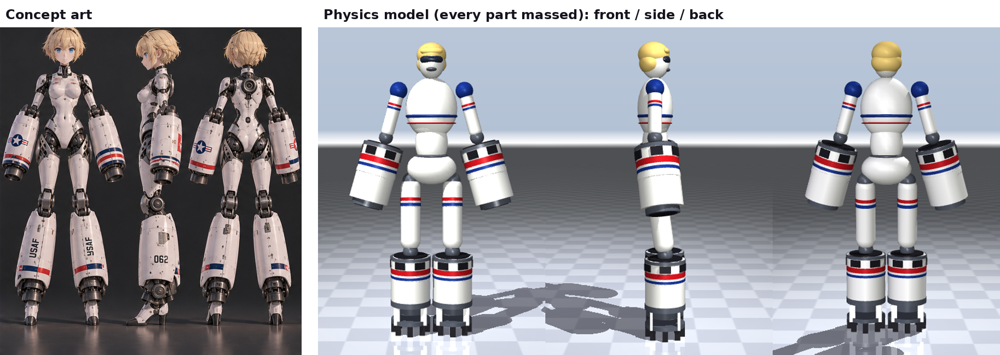

## 2. Design phase: from shelf parts to one feasible design

<p align="center">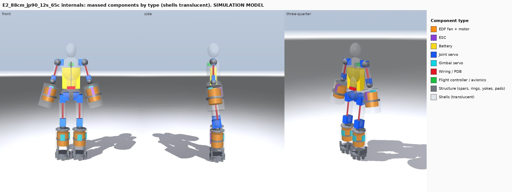<br><i>Final design internals, color-coded by component type: fans, servos, battery, ESCs and structure</i></p>

<p align="center">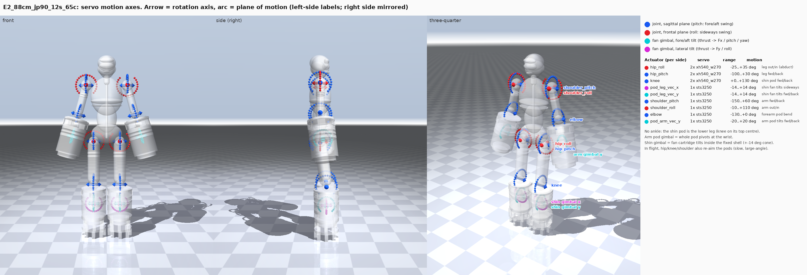<br><i>Every actuated joint and the plane of motion it provides, including the fan gimbals</i></p>

### Choosing the parts

I built a component catalog ([`configs/hardware.yaml`](configs/hardware.yaml)) of 6 EDF power systems (screened from the Freewing and JP Hobby lines), 4 servo models, ESCs, batteries and a flight controller. Every value is either **verified** (manufacturer or retailer page, with link) or **marked as an assumption**.

- **Fans:** chosen first on *trustworthy data* (published thrust-vs-voltage tests), then on thrust per housing diameter, because the pod diameter sets the robot's size. The winner, JP Hobby's 90 mm 12S unit, gives **30% more thrust than its 8S sibling in the same housing**.
- **Servos:** chosen automatically per joint. Required continuous and peak torque are computed from the robot's mass and poses, with continuous torque capped at 35% of stall (stall is only a momentary rating). Servos may be ganged in pairs, and the code picks the lightest option that passes.
- **Battery:** chosen on *current*, not just capacity. A cheaper 35C pack caps the four fans' total draw, so it failed the gate.

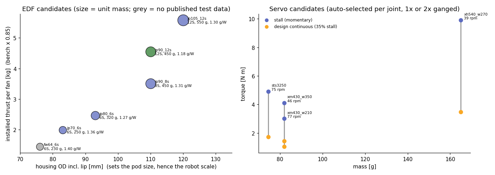

### Choosing the size

The pods must look oversized (about 13% of height), so **each fan size implies a robot height**: 64 mm → 0.55 m, up to 105 mm → 0.96 m. Each candidate is assembled part by part (shells, servos, wiring, battery, fans) and weighed.

Size also changes the physics, and the gate checks each effect on the actual assembled model:
- **Mass vs thrust:** from 0.55 m to 0.88 m, mass grows 1.9× (5.7 → 10.7 kg), but usable thrust per fan grows 3.2× (14 → 43 N). That's because fixed-weight parts (battery, ESCs, flight controller) don't shrink with the robot, while bigger fans get disproportionately stronger.
- **Joint torque:** the gravity torque a joint holds is mass × lever arm, and both grow with height. At 0.88 m the hip needs 6 N·m continuous (10 N·m peak), which takes paired XH540 servos. Servos are then the heaviest subsystem (2.4 kg), which the sizing loop feeds back into the mass.
- **Centre of mass:** with fixed proportions, the COM stays at about 49% of height (0.27 m → 0.43 m). The pod footprint grows at the same rate, so the static tip-over angle stays roughly constant (about 4–5°). A taller robot actually falls more slowly: the fall time constant √(h/g) goes from 166 to 210 ms, which gives the controller more time to react.
- **Attitude control in flight:** rotational inertia grows as mass × height², but the pods' lever arm grows only with height. A bigger robot therefore turns more sluggishly per newton of thrust difference. The gate's control-authority check covers this.

**Key finding: smaller is not easier.** Below about 0.85 m, no shelf fan lifts the robot with useful margin: thrust/weight is 0.99 at 0.55 m vs 1.64 for the chosen 0.88 m design.


### Smoke-testing before training

Every candidate is built in MuJoCo and has to pass the gate before any GPU time is spent. The checks are:
- **Thrust:** thrust/weight (nominal and worst case), with thrust limited by battery current, not just the fan curve.
- **Control authority:** a hover trim exists, and full 6-DOF control holds (rank and conditioning of the thrust-vectoring Jacobian), with yaw authority vs reaction-torque uncertainty.
- **Power and electronics:** hover endurance, and pack/ESC current and voltage within ratings.
- **Mechanics:** servo torque margins, and a 3 s physics test that it can stand.
- **Aesthetics:** the pods must actually look oversized, and the shin pods must not collide.

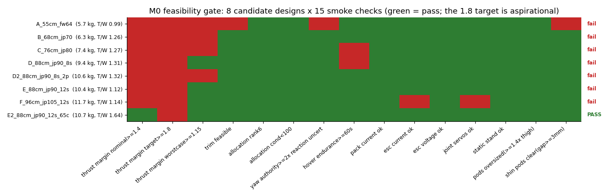

### Iterating the selected design

| Iteration | Change | Why |
|---|---|---|
| v0 | Shin pods behind the shins like calves; small ankles and feet | First feasible layout |
| v1 | **The shin pod *is* the lower leg:** the knee mounts on its top; no ankles or feet | Match the concept art. This killed pitch control from differential thrust. |
| v1 gimbal study | Compared 4 thrust-vectoring layouts → **2-axis gimbal on the shin fans** | Restored full 6-DOF authority (pitch ±4.7 N·m) |
| v2 | Fan raised, **vented skirt** below | Exhaust exits 84 mm above the floor instead of 31 mm, with 3.7× more escape area at liftoff |

**Final design:** 0.88 m, **10.74 kg**, 4 × 90 mm 12S EDFs, 18 servos, installed thrust/weight **1.64**, hover **8.7 kW**, about **60–80 s** of flight, about **$9.2k** in parts ([BOM](results/m0/bom_E2_88cm_jp90_12s_65c.csv), [gate report](docs/M0_feasibility.md)).

## 3. Training phase: validating the design with learned control

### Setup

- **Simulation:** MuJoCo on the GPU (MJX with the Warp backend), **8192 robots in parallel**, about 150k control steps/s. That puts one policy at 10–30 min.
- **Physics beyond MuJoCo:** servo torque–speed limits and heating; fan spin-up lag; battery voltage sag and current limits; motor reaction torque; ground effect of **unknown sign**; randomized mass, thrust and sensor bias.
- **Sensors:** the policies see only what a real robot could measure (IMU, encoders, rangefinder, a noisy velocity estimate, fan commands, battery voltage, foot switches).
- **Learning:** PPO with an asymmetric critic. Policies warm-start each other (hover → transition → fan failure).

### Reward design (high level; full weights in [experiments.md](docs/experiments.md#b3-reward-design-per-task))

| Task | What it's rewarded for | What it's penalized for |
|---|---|---|
| Stand | upright, still, at nominal height, pods flat | falling, using thrust, overheating servos |
| Walk | tracking a speed command, lifting each pod along a **gait-clock** swing profile | **pods sliding while in contact**, falling |
| Hover | holding altitude and position (fine + coarse tolerance), level attitude | ground contact, power, throttle saturation |
| Transition | following a stand → climb → hold → descend → stand profile, both pods down on the ground | **hard touchdowns**, **any thrust left on after landing** |
| Maneuver | tracking velocity commands (including "stop"), holding altitude | crashing, power |
| Fan failure | a controlled descent after a random fan dies | tipping over, hard impact |

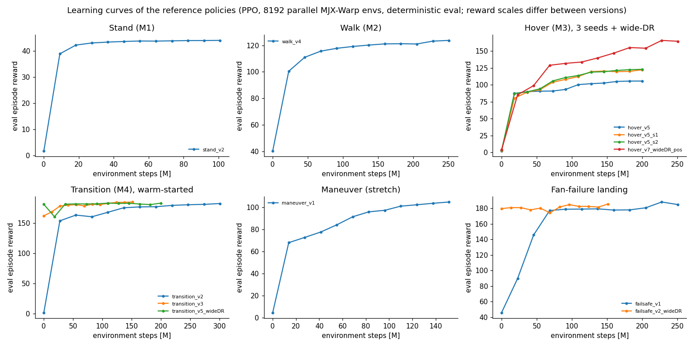

### Key challenges and how they were solved

**1. A "mysterious" collapse in every flight policy.** Training peaked, then decayed. Tuning PPO didn't fix it. The real cause was the simulator wrapper: at each episode reset it kept the *battery charge and timers* from the previous episode, so the batteries slowly drained across training. One flag (`full_reset=True`) fixed it, and every curve afterwards rose monotonically.

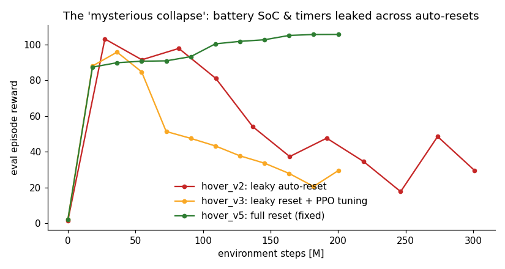

**2. Walking that "passed" but wasn't walking.** The first walker hit the distance target by shuffling, with 7 mm pod lift and 45% sliding. I added gait-quality metrics, a gait clock and a true slip penalty. A further fine-tune got stuck rolling the disc pods on their rims, until I found that a "keep pods flat" reward term was blocking the lift. Retrained from scratch without it: **42 mm clearance**.

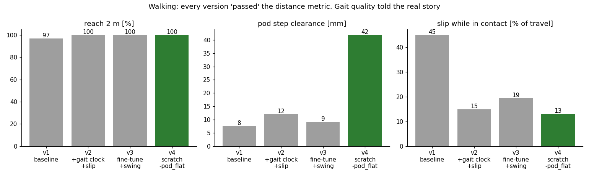

**3. A landing that "stood" on its fans.** A transition policy scored 96%, but the video showed it kept **30% of its weight on the fans** after landing. I tightened the success criterion and added a post-landing thrust penalty: 91–94% under the strict test.

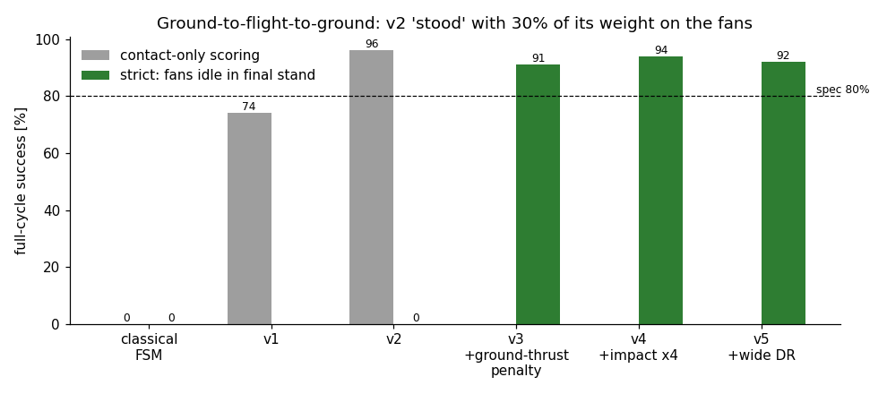

**4. Robustness had to be trained, not hoped for.** Doubling the randomization width raised hover success under −20% thrust from 66% to 81%, and under one half-power fan from 66% to 92%. That robustness came from the policy, not new hardware.

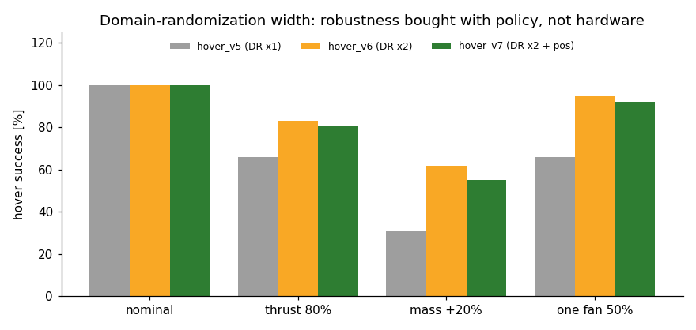

**What didn't work** (details in [experiments.md](docs/experiments.md#b8-things-that-didnt-work)):
- PPO hyper-parameter tuning against the collapse (wrong root cause)
- fine-tuning out of a bad gait (local optimum)
- shaping descent speed to soften the hardest landings (no effect on the tail)
- a stateless classical hover controller (26%)

## 4. Results

All results are on 100 randomized trials, held-out seed, using the project's pass criteria:

<table>
<tr><th>Behavior</th><th>Target</th><th>Result</th><th>Clip</th></tr>
<tr><td>Stand 30 s, fans off</td><td>≥ 95%</td><td><b>100%</b>, sway about 1 cm. Push recovery: 0.3 m/s by stepping, <b>0.6 m/s with fan bursts</b>.</td><td></td></tr>
<tr><td>Walk ≥ 2 m, fans off</td><td>≥ 80%</td><td><b>100%</b>, 0.135 m/s, 42 mm clearance, 13% slip</td><td></td></tr>
<tr><td>Hover 20 s (±0.15 m, ±10°)</td><td>≥ 90%</td><td><b>100% on 3 seeds</b>, altitude RMS 1.1–2.3 cm, drift 8 cm</td><td></td></tr>
<tr><td>Stand → fly → land → <b>unassisted</b> stand</td><td>≥ 80%</td><td><b>94%</b> (92% for the more robust version)</td><td></td></tr>
<tr><td>Air maneuvers + stop</td><td>stretch</td><td><b>100%</b>, 0.07 m/s error</td><td></td></tr>
<tr><td>Single-fan failure → landing</td><td>quantify</td><td><b>97%</b> (0% untrained)</td><td></td></tr>
</table>

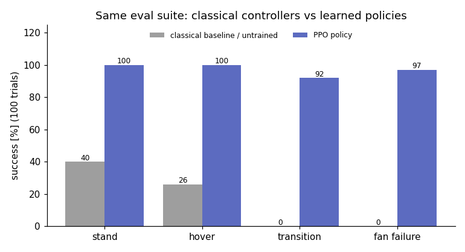

**What the simulation says about building it:**
- the binding limits are **thrust margin and fan failure**, not latency, noise or ground effect;
- **downward optical flow is required**, because without a velocity estimate the hover drifts about 10 m/s;
- a fan-failure signal (ESC telemetry) enables a safe emergency landing;
- walking runs the leg servos at 86% of their thermal rating.

## Limitations

The thrust model is fitted to bench data plus assumptions (0.85 installed efficiency, spin-up lag, reaction torque); there's no CFD. Ground effect is a bounded uncertainty, contacts are rigid, servo continuous ratings and battery resistance are assumed, and no state estimator was implemented. Thrust/weight (1.64) is below the 1.8 target. The prototype plan in [REPORT.md](docs/REPORT.md#6-path-to-a-tethered-physical-prototype) starts with a thrust-stand test of one pod for exactly these reasons.

## Repository

```text
configs/      component catalog (verified vs assumed, with sources) + candidate designs
models/       parametric design -> MuJoCo model (render + identical-mass training variant)
hardware/     feasibility gate: budgets, current-limited thrust, control allocation, Pareto
controllers/  6-DOF thrust allocation + classical baselines
envs/         GPU environment with servo, fan, battery and ground-effect models
training/     PPO trainer, single-GPU job queue, reference policies (training/policies/)
evaluation/   fixed evaluation suite, robustness sweeps, figures
scripts/      renders, diagrams, rollout videos, GIFs
docs/         experiments.md (every run and lesson), REPORT.md, M0_feasibility.md
```

```bash
uv venv .venv -p 3.10 && uv pip install --python .venv/bin/python -r requirements.txt
source scripts/env.sh                                   # CUDA libs (WSL) + headless rendering
python hardware/sizing.py                               # design gate -> results/m0/
python training/train.py --task hover --name my_hover --steps 200e6 --discount 0.99
python evaluation/evaluate.py --task hover --params training/policies/hover.pkl
```

**Deep dives:** [design and training log](docs/experiments.md) · [engineering report](docs/REPORT.md) · [feasibility gate](docs/M0_feasibility.md) · [robustness tables](results/m5_robustness.md) · [original project brief](docs/PROJECT_BRIEF.md)

## License

Code, models, figures and simulation renders are released under the [MIT License](LICENSE). **Excluded:** the concept art (`docs/assets/concept_art.png`, `docs/assets/concept_flight.png`, and the concept panels in `docs/assets/concept_vs_model.png`) was generated with ChatGPT and is not covered by this license.
