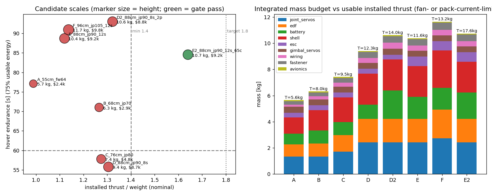

# M0 feasibility gate: EDF humanoid

*Status: preliminary, revised 2026-10-23: shin pod now forms the lower leg (no ankle or foot), per the concept art. All numbers come from `hardware/sizing.py` and the MuJoCo model. Re-run it to reproduce them.*

## Verdict

**Conditional pass. One configuration clears the minimum gate, and none reaches the 1.8 thrust-to-weight target.**

| | E2 (selected) |
|---|---|
| Height / mass | 0.88 m / **10.73 kg** (all components massed, nothing massless) |
| Propulsion | 4 × JP Hobby 90 mm 12-blade 12S (JPH6007-104), 4 × Hobbywing FlyFun 110A HV V5 |
| Battery | 2 × 6S 6000 mAh 65C in series (12S, 390 A cont.) |
| Installed thrust | 4 × 43.2 N (bench 52.5 N × 0.85 install, then **battery-current-limited**) |
| Thrust/weight | **1.64** nominal · 1.55 at 3.5 V/cell · **1.37** worst case (η=0.75, end-of-pack) |
| Hover | 60% throttle, 8.5 kW, 191 A, ~1.26 g/W |
| Hover endurance | 85 s at 75% usable energy, but **~60 s if pack heating is limited to +35 K** |
| Allocation | rank 6, cond 6 (normalized), trim feasible with gimbals within 1% of their range |
| Attainable torque at trim | roll ±12.0 N·m · pitch +4.8/−4.6 N·m · yaw ±3.9 N·m |
| Yaw vs. reaction-torque uncertainty | 3.9 vs 0.58 N·m (6.8×) |
| Standing (EDFs off, on shin-pod rims) | stood for 3 s under PD; worst actuator load 20%; COM margin 4.1 cm aft, 7.6 cm fore, 12.2 cm lateral |
| Cost | ~$9.2k (Dynamixel XH540s are ~45% of it) |

## Scale comparison (Pareto)



| Candidate | H | EDF | Mass | T/W nominal / worst | Hover | Gate |
|---|---|---|---|---|---|---|
| A | 0.55 | Freewing 64 mm 6S (thrust **unverified**) | 5.6 | 0.99 / 0.83 | 77 s | ✗ cannot lift itself; shin pods collide |
| B | 0.68 | JP 70 mm 6S | 6.3 | 1.27 / 1.02 | 71 s | ✗ thrust |
| C | 0.76 | JP 80 mm 6S | 7.4 | 1.28 / 1.07 | 58 s | ✗ thrust, endurance |
| D | 0.88 | JP 90 mm 8S | 9.4 | 1.31 / 1.15 | 56 s | ✗ thrust, endurance |
| D2 | 0.88 | JP 90 mm 8S, 2P packs | 10.6 | 1.32 / 1.05 | 93 s | ✗ thrust |
| E | 0.88 | JP 90 mm 12S, 35C packs | 10.4 | 1.12 / 0.99 | 89 s | ✗ the 35C packs cap current at 210 A |
| **E2** | **0.88** | **JP 90 mm 12S, 65C packs** | **10.73** | **1.64 / 1.37** | **85 s** | **✓ (below 1.8 target)** |
| F | 0.96 | JP 105 mm 12S | 11.6 | 1.14 / 1.00 | 91 s | ✗ current-limited, ESC 114 A > 110 A, servos |

**Key findings**
1. **Smaller is not easier.** Fan thrust scales roughly with D², but the legs that must carry the pods scale too. Below about 0.85 m, no catalog fan gives more than 1.3× installed T/W once real servos, shells, wiring and a battery are counted. Small and cute does not fly.
2. **Leg actuators are the largest mass item** (2.4 kg joint servos, plus 0.45 kg gimbal servos), ahead of the battery (2.0 kg) and the EDFs (1.8 kg). Hip roll, hip pitch and knee each need two XH540s ganged. Removing the ankles saved about 0.8 kg of servos, but a 2-axis shin gimbal and a load-bearing shin shell spent most of it again.
3. **The battery, not the fan, sets maximum thrust.** At full throttle, four 12S fans draw 408 A. Even 65C packs only supply 390 A, which is why E (35C) fails while E2 passes.
4. **Endurance is about one minute.** That is enough for the M4 cycle (5 s hover plus transitions), but not for a demo loop. Pack heating is likely the binding limit, not capacity.

## Mass budget (E2)

| Item | kg |
|---|---|
| Joint servos (XH540-W270 ×12, STS3250 ×6) | 2.43 |
| Shells (PETG 1.2 mm, ribbed; load-bearing shin shells ×1.35), spars, gimbal rings, rim pads | 2.36 |
| Battery (2 × 6S 6000 65C) | 2.00 |
| EDF + motor ×4 | 1.80 |
| ESC ×4 | 0.72 |
| Fasteners/bearings/inserts (5%) | 0.51 |
| Gimbal servos ×6 (STS3250: 1 per arm pod, 2 per shin pod) | 0.45 |
| Wiring (8 AWG pod runs, PDB, bus) | 0.39 |
| FC + avionics | 0.08 |
| **Total** | **10.73** |

The BOM with sources is in `results/m0/bom_E2_88cm_jp90_12s_65c.csv`. Every catalog entry in `configs/hardware.yaml` is tagged `verified` (with source URL and check date) or `assumption`.

## Architecture decisions and deviations from the reference

- **The shin pod is the lower leg**, matching the concept art. The knee yoke sits on the pod's top centre (coaxial), with no ankle and no foot. The robot stands on 8 rubber pads around the pod rim (118 mm base). The fan sits just under the intake, and below it a vented 4-strut skirt carries the load to the pads. The nozzle exits **84 mm** above the floor, giving a radial escape area 3.7× the nozzle area. *(The earlier full-length duct exited at 31 mm with only 1.1×.)*
- **DOF:** 18 joint and gimbal actuators plus 4 fan commands. Each leg has hip roll, hip pitch and knee. Each arm has shoulder pitch, shoulder roll and elbow. Each arm pod has a 1-axis gimbal, and each shin pod a 2-axis gimbal. There is no hip yaw yet, so turning is deferred.
- **Without ankles, balance comes from the hips and knees.** The centre of pressure moves across the pod base (±5 cm), which the knee sizing includes (M g r_pod peak). Walking will look like stepping on stilts with wide bases. That is an M2 risk, not a blocker for standing.
- **Vectoring.** Arm pods tilt fore/aft (±20°), with the whole pod gimbaled at the wrist. Shin pods have a lip-less fan cartridge on a 2-axis gimbal *inside* the fixed shell, limited to **±14°** by bore clearance. The intake bellmouth is moulded into the shell.
- **Why the shins need 2 axes.** With the shin pods coaxial under the knees, the arm and leg pods share a frontal plane, so differential thrust makes no pitch torque. Layouts checked on E2 hardware:

  | Layout | Result |
  |---|---|
  | leg 1-axis lateral | rank 5 (singular) in the balanced pose |
  | leg fore/aft only | lateral force only ±4 N |
  | arm lateral + leg fore/aft | rank 5 |
  | **leg 2-axis** | **rank 6, cond 6, pitch ±4.7 N·m (+0.31 kg)** |

  The LP treats the 2-axis gimbal as a ±14° box, but the real limit is a 14° cone, so the controller must enforce the cone.
- **Gimbaling the cartridge avoids exhaust-vane losses** but adds gyroscopic load (0.65 N·m at 2 rad/s), which is included in the gimbal servo sizing.
- **Forearm pods are coaxial with the forearm** and extend past the wrist; there is no separate hand. The intake breathes through an annular top face around the elbow yoke plus side louvres.
- **Standing pose has the arms abducted 17°** so the forearm pods and their exhaust clear the thighs. This costs about 4% of vertical arm thrust.
- **Pod OD is 118 mm**, which is 1.98× the thigh and 3.1× the upper arm, and 13.5% of height.
- **Hair (short bob) and face are visual only** (zero mass, no collision).

## Risk register

| # | Risk | Severity | Evidence | Mitigation / next check |
|---|---|---|---|---|
| R1 | Pitch authority (±4.7 N·m, about 11 rad/s² with I_yy 0.42 kg·m²) depends entirely on the shin-cartridge gimbals (±14°, slew about 2 rad/s, plus 0.16 s fan spool) | Med-High | allocation LP | M3 dynamic test with servo and motor lag |
| R2 | T/W of 1.64 is below the 1.8 target, and **1.36 worst case** | High | sizing | Thrust-stand test of one installed pod (roadmap step 1). Mass reduction targets: shells (2.1 kg) and leg servos. |
| R3 | **Pack heating**: +47 K over 84 s at the assumed 2.5 mΩ/cell | Med-High | sizing | Measure pack IR. Cap the flight at about 60 s. |
| R4 | **Shin jets fire at the floor from 84 mm** (h/D ≈ 1.1) through the skirt vents (escape area 3.7× the nozzle area; it was 1.1× at 31 mm before the skirt redesign). Some ground effect and recirculation at liftoff remain, and MuJoCo doesn't model them. | Med-High | geometry | Stand test of one pod against a ground plane. Policies trained with a ±15% thrust band near the ground of unknown sign, and pass M4 at both extremes (96% / 94%). |
| R5 | EDF reaction torque: no counter-rotating JP units exist, so all four fans spin the same way. Residual after the stators is assumed to be 25%. | Med | assumption | Yaw margin is 5.5×; measure on the stand. |
| R6 | Installed efficiency of 0.85 (side intake, guard, gimbal gap) is assumed | High | assumption | CFD or stand test of the pod (roadmap step 3). |
| R7 | Standing and walking without ankles on round pod bases: the COM must stay within about 4 cm of each pod centre in single support | Med-High | support polygon | M1 sweeps, then an M2 gait with hip-roll weight shift. Fallback: a passive rocker sole on the rim. |
| R8 | FlyFun 110A HV runs at 102 A at full 12S throttle (93% of rating). Hover is about 50 A. | Low-Med | catalog | Throttle cap, ESC temperature telemetry |
| R9 | 80/90/105 mm unit lengths and 64 mm thrust/mass are not published | Med | catalog | Request datasheets |
| R10 | Servo continuous rating assumed to be 35% of stall | Med | assumption | Servo bench test at the knee/hip operating points |

## Procurement gate status

There are exact, purchasable candidates for every critical part (EDF, ESC, packs, servos, FC) with supplier links. Prices and stock were read from listings on 2026-10-23, and stock status was not displayed on MotionRC. **Hardware feasibility is still provisional** until R2, R4 and R6 are measured.

## Implementation plan (next)

1. **M1 standing:** `envs/stand.py`, a joint PD with gravity compensation, 100 randomized 30 s trials (friction, mass ±10%, COM offsets).
2. **M3 hover before M2:** M3 retires the biggest risk (R1). It needs a fan model (curve, 0.16 s spool lag, reaction torque, battery sag) plus the allocator from `controllers/allocation.py`, with cascaded attitude/position control on IMU-only estimates.
3. **M2 walking:** a ZMP/FSM gait at about 0.1 m/s, keeping the narrow feet.
4. **M4 transitions:** the FSM with ground-effect uncertainty bands, then M5 sweeps.

## Reproduce

```bash
python hardware/sizing.py                       # gate, Pareto, BOMs -> results/m0/
python scripts/render.py E2_88cm_jp90_12s_65c   # turnarounds + internals
```
